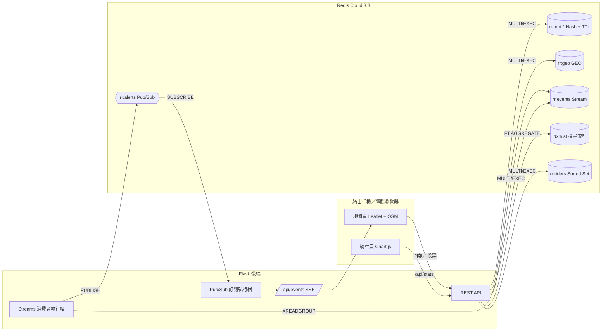

# 🏍️ RideAlert 騎士即時路況回報系統

> 115-1 資料庫管理 · Redis Side Project 個人小專題
> 國立臺北商業大學 資訊管理系 二乙

騎機車最怕的，是轉過彎才發現前面有臨檢、事故、坑洞或積水。
RideAlert 讓騎士在地圖上**一鍵回報路況**，附近的騎士**馬上收到通知**；臨檢這種一下就結束的路況，時間到了**自動消失**，不會一直留在地圖上誤導人。

## 功能

| 頁面 | 功能 |
|---|---|
| 🗺️ 地圖 | 查看附近 1～10 公里的路況、拖曳地圖對準位置回報 6 種路況、按「還在／已排除」、依類型篩選 |
| 🔔 即時通知 | 有人回報新路況，附近所有騎士畫面立刻跳出「⚠ 前方 0.4 km：事故」 |
| 📊 統計 | 近 7／30／90 天：各區回報數、一天中的時段、類型比例、星期分布、熱心騎士排行、最新事件 |

| 路況 | 自動消失時間 |
|---|---|
| 臨檢 | 30 分鐘 |
| 事故 | 1 小時 |
| 積水 | 3 小時 |
| 施工 | 1 天 |
| 坑洞 | 7 天 |
| 測速照相 | 30 天 |

## 用到的 Redis 功能

| Redis 功能 | 指令 | 在系統裡做什麼 |
|---|---|---|
| **TTL 自動過期** | `EXPIRE`、`TTL` | 每筆路況依類型自動消失；有人按「還在」就延長 15 分鐘 |
| **GEO 地理查詢** | `GEOADD`、`GEOSEARCH` | 查「我附近 3 公里」有哪些路況，依距離排序 |
| **Streams** | `XADD`、`XREADGROUP`、`XACK`、`XREVRANGE` | 所有事件（新回報、投票、移除）寫進串流；背景消費者群組讀取後推播 |
| **Pub/Sub** | `PUBLISH`、`SUBSCRIBE` | 把事件即時廣播給所有連線中的騎士（再用 SSE 送到瀏覽器） |
| **Transactions** | `WATCH`、`MULTI`、`EXEC` | 多人同時投票不會算錯；3 人按「已排除」就原子性刪除 |
| **Pipelines** | `pipeline()` | 查附近時一次取回所有路況的 Hash 與剩餘 TTL；匯入歷史資料 |
| **Index** | `FT.CREATE` | 對歷史紀錄 `hist:*` 建索引（TAG、NUMERIC、GEO） |
| **Aggregation** | `FT.AGGREGATE … GROUPBY … REDUCE COUNT` | 統計頁：依區域、時段、類型、星期分組計數 |
| **Sorted Set** | `ZINCRBY`、`ZREVRANGE` | 熱心騎士排行榜 |

### 為什麼用 Redis，不用傳統 SQL？

- **會自己消失的資料**：SQL 要寫排程定期刪除過期資料；Redis 一個 `EXPIRE` 就好。
- **即時推播**：SQL 只能讓前端一直輪詢；Redis Pub/Sub ＋ Streams 有事件就推。
- **附近查詢**：SQL 要自己算經緯度距離；Redis `GEOSEARCH` 內建，而且在記憶體裡非常快。

## 系統架構



更多 UML 圖（用例圖、循序圖、狀態圖）在 [`docs/`](docs/)。

## 資料結構

| Key | 型態 | 內容 |
|---|---|---|
| `report:{id}` | Hash（有 TTL） | 類型、經緯度、說明、回報者、時間、還在／已排除票數、行政區 |
| `rr:geo` | GEO（Sorted Set） | 路況 id ↔ 經緯度 |
| `hist:{id}` | Hash | 歷史紀錄（給統計用，不會過期） |
| `idx:hist` | 搜尋索引 | `type`、`area` TAG；`hour`、`wday`、`created` NUMERIC；`loc` GEO |
| `rr:events` | Stream | new／vote／removed 事件，消費者群組 `notifier` |
| `rr:alerts` | Pub/Sub 頻道 | 即時推播 |
| `rr:riders` | Sorted Set | 騎士貢獻分數 |

## 執行方式

```bash
pip install -r requirements.txt
# 連 Redis Cloud：在專案資料夾建立 .env，內容 REDIS_URL=redis://default:<密碼>@<主機>:<port>
# 不設定 REDIS_URL 會用 fakeredis 本機模擬（統計改用 SCAN 計算）
python app.py          # 開啟 http://localhost:5080
python seed.py         # 匯入示範資料（只在資料庫是空的時候）
```

## 技術

Python 3 · Flask · redis-py · Redis Cloud 8.8（含 Redis Query Engine）· Leaflet + OpenStreetMap · Chart.js · Server-Sent Events · Render（雲端部署）

## 參考資料

- Redis 官方文件：GEO、Streams、Pub/Sub、Transactions、Pipelining、Redis Query Engine Aggregations（redis.io/docs）
- 課程講義：資料庫管理 W10 Redis 鍵值資料庫簡介及應用、Redis 進階應用
- Leaflet、OpenStreetMap、Chart.js 官方文件
